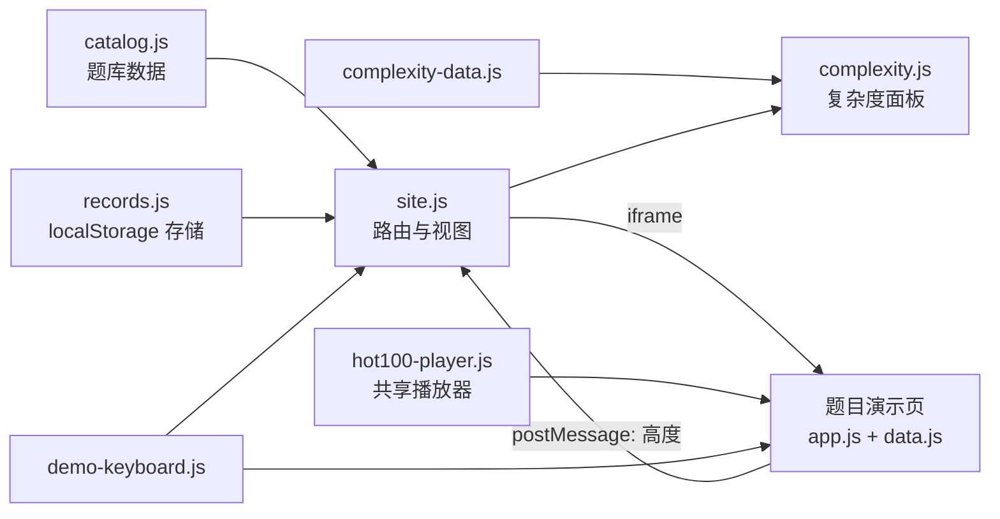
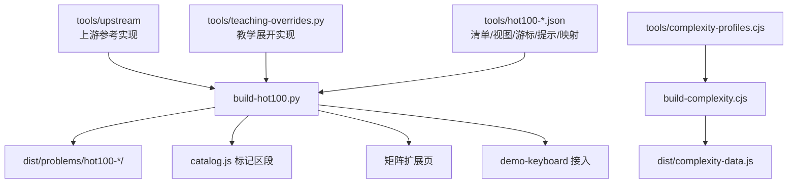

# 架构说明

本文描述站点**现在**如何组织，以及新增功能时应该落在哪一层。维护操作（环境、命令、发布）见
[MAINTAINING.md](MAINTAINING.md)，内容生产细节见 [CONTENT-PIPELINE.md](CONTENT-PIPELINE.md)。

## 1. 站点形态

- 纯静态站点，没有运行时构建步骤；`dist/` 就是发布产物，由任何静态服务器托管（线上使用私有 Sites 工作流）。
- 单页应用，使用 hash 路由：`#/home`、`#/library`、`#/backup`、`#/problem/<id>`。
- 每道题的交互演示是一个独立 HTML 页面，通过 `<iframe>` 嵌入详情页；父子页面用 `postMessage` 同步高度。
- 浏览器端**不执行** Python/Java：执行轨迹是构建期由真实代码跑出来的数据，页面只做回放。
- 支持 `file://` 直接打开：全部资源使用相对路径、脚本用 `<script>` 同步加载、无 `fetch`。

## 2. 运行时分层

| 模块 | 位置 | 职责 | 修改入口 |
| --- | --- | --- | --- |
| 题库数据 | `dist/catalog.js` | 题目元数据、分类、标签、题面、要点、易错点 | 手工条目直接编辑；Hot 100 标记区段由构建器维护 |
| 站点运行时 | `dist/site.js` | hash 路由、首页/题库/详情/备份视图、iframe 高度协议 | 直接修改，保持单一 IIFE 与 `esc()` 转义约定 |
| 个人记录 | `dist/records.js` | `algorithm-notebook.v1` 读写、校验、备份合并 | 修改必须同步 `tests/unit/records-check.cjs`，升级需迁移 |
| 复杂度面板 | `dist/complexity.js` + `dist/complexity-data.js` | 渲染结构化的最好/最坏分析 | 改 `tools/complexity-profiles.cjs` 后重新生成 |
| 键盘控制 | `dist/demo-keyboard.js` | ←/→ 映射 `prev`/`next` 按钮，编辑区保护 | 由 `tools/build-demo-keyboard.py` 接入各页面 |
| 生成题演示 | `dist/problems/hot100-<题号>/` | 页面 + `app.js`（双语言代码）+ `data.js`（离线轨迹） | `tools/build-hot100.py` 生成 |
| 共享播放器 | `dist/problems/hot100-player.js` | 按轨迹快照渲染代码高亮、调用栈、状态与结果 | 直接修改，89 题共用；改动需全量浏览器验收 |
| 手写题演示 | `dist/problems/<目录>/` | 独立页面与演示脚本（14 道旧题；其中 robber 含四阶段 DP） | 直接修改；后续计划迁移到共享播放器 |

### 详情页请求流程

1. `route()` 解析 `#/problem/<id>`，从 `window.PROBLEMS` 取题目。
2. `complexity.js` 用 `window.COMPLEXITY_ANALYSIS[id]` 渲染分析面板。
3. 插入 iframe 指向 `p.demo`；演示就绪后发送 `{ type: 'algorithm-demo-ready', height }`，
   父页面校验 `event.source` 与同源 `origin` 后设置高度（clamp 450–12000px）。
4. 首次进入写入 `lastVisited`；笔记/掌握程度变更即时写入 localStorage。

### 演示回放流程

`data.js` 提供 `{ cases: [...] }`，每个 case 含 `events[]`；每个 event 带 Python 行号 `line`、
Java 行号 `javaLine`、调用栈 `stack`、容器/节点状态 `nodes` 与中文解释。播放器只做状态渲染，
不重新执行算法；语言切换时沿用同一个事件索引，读取对应语言的代码片段与行号。

## 3. 内容生产流水线

- **Hot 100（89 题）**：Python 代码实际执行生成轨迹，Java 代码另行编译运行同一批输入；
  轨迹与独立答案核对后写成 `data.json`，再包装成 `data.js` 供离线打开。
- **锁文件**：`hot100-line-maps.json` 绑定两份代码的 sha256 与逐行映射；`complexity-code-lock.json`
  绑定当前展示代码。代码改动而锁未更新时构建/检查直接失败，不会猜测高亮位置。
- **手写题（14 题）**：页面与演示均为源文件，由 `catalog.js` 手工区段登记。
- **生成边界**：`dist/` 里的手写页面是源码，生成文件不能手工大改，也不能删除整个目录重建。

## 4. 关键不变量

新增功能不得破坏以下约束，破坏时浏览器验收或 CI 应失败：

1. **题目 ID 稳定**：`catalog.js` 的 `id` 同时是 URL、笔记存储键和生成器索引，发布后不改名。
2. **双语言**：每道题、每个新增解法同时有 Python 与 Java，语言选择器值为 `Python`/`Java`，
   切换语言保留示例与进度，事件带两套行号。
3. **轨迹可信**：轨迹由真实执行生成，且能被 `tools/verify-hot100.py` 逐快照重放；
   禁止手工伪造事件。
4. **映射显式**：Python 行到 Java 行的映射必须人工核对并用摘要锁定，构建器不得自动猜测。
5. **复杂度以代码为准**：改代码必须复核 `complexity-profiles.cjs` 并更新代码锁，
   `--accept-reviewed-code` 只记录已核对摘要，不代表分析正确。
6. **记录兼容**：`algorithm-notebook.v1` 的 schema 只做兼容性扩展；导入必须整体校验、
   写入失败保留原记录；未知题目的记录也要保留。
7. **离线可用**：不引入运行时网络请求、模块打包器或需要服务器的能力；保持 `file://` 可打开。
8. **隐私**：无账号、无埋点、无外部字体/CDN 请求；个人数据只存本地。
9. **桌面优先**：当前只保证桌面浏览器体验，新增功能不要求手机专项验收。

## 5. 新增内容时的扩展点

| 需求 | 做法 | 验证 |
| --- | --- | --- |
| 新增页面 | `site.js` 的 `route()` 加分支，写独立渲染函数 | 主站浏览器验收 + 手动检查返回/刷新 |
| 新增手写题 | `dist/problems/<id>/` + `catalog.js` 手工条目 + 复杂度条目 | `tests/unit` 对应检查、`languages-check`、浏览器验收 |
| 新增 Hot 100 题 | 修改生成器与数据（固定 89 题集合，尚未自动化接纳新题号） | 生成后 `npm test` 全量 |
| 新增存储字段 | `records.js` 的 `validateRecords` 与 `emptyRecord`，同步 records 检查 | 迁移旧数据、导入导出、损坏容忍 |
| 新增共享脚本 | 按 `index.html` 现有顺序追加，保持无 `fetch`/无 ES module | 本地文件打开与主站验收 |
| 新增检查 | `tests/unit/` 或 `tests/browser/` 放文件，并登记到 `tests/run-all.cjs` 的 `GROUPS` | `node tests/run-all.cjs unit` |

## 6. 已知取舍与技术债

这些是当前有意保留或尚未处理的问题，详细计划见 [ROADMAP.md](ROADMAP.md)：

- `dist/` 同时承担源码与发布产物，手写页面与生成文件混在一起；暂不迁移到 `src/`（迁移成本高于收益）。
- 89 题的 `data.json`（约 4.6 MB）与 `data.js` 内容重复，且随站点一起发布；仅用于构建期校验。
- 14 道旧题各自复制了一套播放逻辑（约 900 行），与 `hot100-player.js` 分叉。
- `site.js` 是单文件运行时不带模块化；功能继续增长时应先按视图拆分，而不是整体换框架。
- 生成器非原子：失败时可能已改写部分题目目录；CI 通过后再发布可降低风险。
- 站点代码尚未有 LICENSE；上游派生内容已按 CC BY-SA 4.0 署名。
